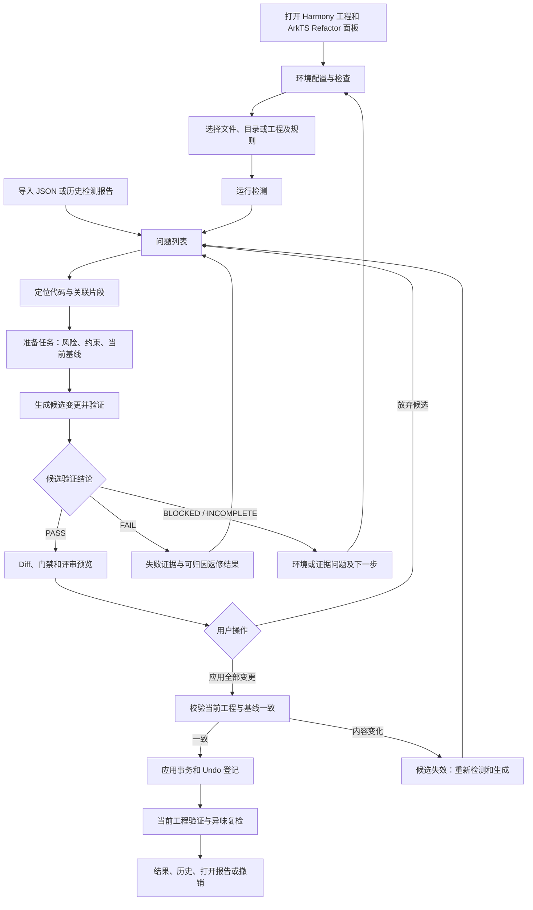
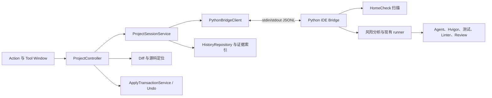

# DevEco 代码异味检测与重构插件：端到端 UI 技术设计

日期：2026-10-14

状态：设计稿；本文描述待实现行为，现有能力单独标明。

插件工程：`C:\Users\RoyCai\Desktop\group_project\arkts-smell-refactor\deveco-plugin`（2026-10-18 合仓后位置）

后端仓库：`C:\Users\RoyCai\Desktop\group_project\arkts-smell-refactor`

编译 JDK：`D:\tool\java21`。

## 1. 目标与设计决定

用户在 DevEco Studio 中完成：选择检测范围 → 检测异味 → 查看与定位问题 → 查看重构风险 → 生成并验证候选变更 → 查看 Diff → 应用变更 → 查看工程验证、复检和历史结果。每一步都有可操作入口、状态反馈和失败后的下一步。

采用 Java 21、IntelliJ Platform 原生 Swing Tool Window 和本地 Python 子进程。检测复用现有 HomeCheck；重构复用 `arkts-smell-refactor` 的风险分析、Agent、验证及返修流水线。插件管理界面、编辑器定位、候选应用和 Undo；Python 管理工具编排、隔离工作区和结构化证据。

执行采用两个阶段：先在候选工程中生成并验证修改，再由用户在 Diff 界面点击“应用全部变更”。现有后端会在 Agent 结束后回写它收到的工程路径，所以插件必须把后端执行目标映射到候选工程。插件上线前不能将当前工程路径直接传给现有执行流水线。

首版以本机 DevEco Studio 为明确适配目标，使用其本地 SDK。Gradle 构建、插件加载和真实工程联调各自验收，不能用普通 Java 编译通过代替插件可用。

## 2. 已核验的仓库与环境

### 2.1 插件现状

| 项目 | 实际情况 | 实施影响 |
| --- | --- | --- |
| `build.gradle.kts` | 仅应用 `java` 插件，配置 JUnit 6.0.0 | 尚无 IntelliJ 插件构建、SDK 依赖和插件 ZIP |
| `src/main/java/org/buaa/Main.java` | 初始化示例程序 | 尚无 Tool Window、Action、服务或 UI |
| `src/main/resources/META-INF/plugin.xml` | 不存在 | 需要注册插件入口和扩展点 |
| Gradle Wrapper | 9.8.0 | 初始方案保留当前版本，验证与插件构建工具的组合 |
| `.idea/misc.xml` | 当前为 JDK 24 | 后续实现时将 Project SDK、语言级别和 Gradle JVM 对齐到 21 |
| 指定 JDK | 实际 `java -version` 为 21.0.12.1 | 可用于插件编译；本轮未执行插件构建 |

### 2.2 宿主现状

从 `D:\tool\DevEco\DevEco Studio\product-info.json`、`build.txt` 和 `jbr/release` 核验：

| 项目 | 值 |
| --- | --- |
| 安装目录 | `D:\tool\DevEco\DevEco Studio` |
| 产品与版本 | DevEco Studio 6.1.1.300 |
| 构建号 | `DS-243.24978.46.36.611300` |
| 内置 JBR | 21.0.8 |
| 编译目标 | Java 21，class major version 65 |

平台分支 `243` 对应 IntelliJ Platform 2024.3，官方表列出的 Java 版本为 21；这与本机运行时一致。[官方版本与 Java 对照](https://plugins.jetbrains.com/docs/intellij/build-number-ranges.html)

### 2.3 后端和检测器现状

| 能力 | 已有实现 | 插件接入方式 |
| --- | --- | --- |
| 环境检查 | `cli.py` 的 `doctor`，输出人类可读文本 | 新桥接层输出每项工具及按功能计算的可用性 |
| 任务准备 | `prepare --dataset --workspace --output [--index]` | 可生成任务、风险和 Prompt；桥接层补充候选工程映射及配置 |
| 重构执行 | `run --task-dir --config [--dry-run]` | 调用现有流水线，在候选工程中执行 |
| 粘贴输入自动执行 | `start` | 保留为原 CLI 功能；插件使用分阶段接口 |
| 风险与专项分析 | `risk.py`、`analysis/` | 展示证据、约束和分析局限 |
| 验证与返修 | `runner.py`、`gate.py` | 保留原有判定，补充结构化进度、取消和验证候选接口 |
| 结果证据 | `task.json`、`gates.json`、`result.json` 等 | 通过适配层转换字段，不让 UI 直接依赖混合命名 |
| 初次异味检测 | 重构后端没有面向 IDE 的扫描命令 | 桥接层新增扫描能力，复用 HomeCheck 入口 |
| Diff 后确认应用 | 现有流水线没有此边界 | 插件新增候选与应用事务 |
| IDE 协议 | 无 HTTP、JSONL IDE 服务或版本协商 | 新增本地 stdio JSONL 桥接，详见[协议](backend-bridge-protocol.md) |

本机检测器位于：

```text
C:\Users\RoyCai\Desktop\group_project\arkts异味检查工具\homecheck-extrule
```

已存在 `node_modules/homecheck/lib/run.js` 和 `extrulesproject-1.0.0.tgz`；`package.json` 的 `scan:files` 实际指向 `scripts/gitcodeArktsPerfTest.js --f1=false`。旁边的 `scripts/scanFiles.js` 不是该 npm 命令入口。

两个需要在设置页处理的本机差异：

1. 后端 `_find_homecheck()` 默认查找工作区附近的 `homecheck-extrule`，不会递归发现当前嵌套目录。桥接层需要显式路径覆盖。
2. 检测器配置仍写有 `E:/DevEco Studio/sdk/...` 和其他机器的工程路径。插件生成本次独立配置，使用当前工程和已检查的 SDK 路径；不把原配置直接用于用户工程。

### 2.4 首版规则范围

| 规则 ID | UI 名称 | 首版行为 |
| --- | --- | --- |
| `@extrulesproject/feature-envy-check` | 特性依恋 | 检测、风险分析、候选重构、验证、应用 |
| `@extrulesproject/long-method-check` | 过长方法 | 同上；突出 ArkUI 状态及 Builder 风险 |
| `@extrulesproject/switch-statement-check` | 复杂分支 | 同上；展示分支结构、fall-through 与推荐形态 |
| `@extrulesproject/code-clone-fragment-check` | 重复代码片段 | 同上；显示关联片段，允许目标符号为空 |
| `formal/god-class`、`formal/directory-cycle` | 上帝类、目录循环依赖 | 后端源码已有专项支持；首版新扫描不承诺检出，导入只读展示，后续单独联调开放执行 |
| Data Clumps 特殊记录格式 | 数据泥团 | 显示不支持原因，不能进入执行 |

`RULE_TYPES` 对未知规则有 fallback，这不表示检测器和完整流水线支持该规则。执行使用明确的能力白名单。

## 3. 用户流程



“生成候选变更”按钮会启动 Agent、验证和必要返修。旁边固定说明“在候选副本中执行，完成后可预览和应用”。“应用全部变更”才是将修改写入当前工程的操作。

### 3.1 检测前

默认范围为当前编辑器中的 `.ets/.ts` 文件。无有效文件时提示选择范围。提供“当前文件”“选中目录”“当前工程”，工程模式按实际 Harmony 工程拆分；检测规则默认选择上述四项，记住用户上次选择。

检测读取磁盘内容。相关 Document 有未保存修改时，显示文件列表及“保存并继续”“返回编辑”；取消不启动检测。扫描冻结文件内容指纹，后续编辑使对应问题显示“代码已变化”。仅修改内容而未保存也触发过期状态。

生成候选前保存并核对所有纳入快照的 Document，包括生产代码、测试和构建配置。初次检测时只检查扫描输入；执行前不能仅保存目标文件。

### 3.2 检测与问题处理

检测期间显示范围、已用时间、当前阶段和取消按钮。检测器没有可靠的文件级百分比时使用不确定进度条，不将运行日志行数换算为百分比。

成功扫描并读取本轮有效报告后才显示“未检出异味”。扫描退出异常、报告缺失和格式错误显示“检测未完成”。历史报告不得作为本轮成功证据。

问题列表可按规则、风险、文件和处理状态筛选，并按文件/规则分组。显示原始 severity、消息、文件、方法或片段、行范围和检测时间。静态风险需准备任务后才有；未计算时显示“待分析”。

双击问题打开文件。普通目标按当前符号及内容定位，数据集旧行号只作提示；复杂分支可能使用 CFG 相对行号。无法可靠重定位时提示重新检测。重复片段支持主片段与所有关联片段跳转，不能因 `target.symbol = null` 禁用任务。

跨 Harmony 工程的关联片段首版显示“跨工程重构暂不支持”。同一个 Harmony 工程内跨模块的克隆正常准备，并展示涉及模块及测试范围。

### 3.3 重构准备与预览

选择问题后点击“分析重构风险”，显示：当前源码、所属类型、生产调用点、ArkUI 状态、专项画像、需要保留的契约和分析局限。约束只读展示，用户可添加业务说明，不能通过说明关闭平台门禁或修改回写边界。

用户点击“生成候选变更”后执行候选流水线，进度中展示每轮修改、验证、返修和独立评审。首次准备的静态建议标记为“建议”，Agent 生成的候选标记为“实际变更”，两者分别显示。

候选验证 PASS 后自动切到变更页；Diff 左侧为生成候选时的当前本地基线，右侧为最终候选。显示每个新增/修改文件，资源变更另列大小和哈希，文本资源可查看 Diff。不存在内容预览的二进制资源显示变更元信息。

首版整项任务应用，所有文件一起接受或一起放弃，不提供逐 hunk 或逐文件应用。跨文件提取依赖完整变更；局部接受需重新定义与验证任务。

### 3.4 应用与完成

应用前比较当前磁盘、Document、候选文件和准备时基线。相关工程内容、测试、配置或工具策略变化，或者预期新增文件已出现，都使候选失效。用户看到具体变化文件和“重新分析并生成”，应用按钮禁用。

事务成功后显示“已应用，正在验证当前工程”。当前工程验证、目标异味复检完成后显示最终结论。失败或阻塞时保持已应用状态，提供“查看诊断”“修复环境后重新验证”“撤销本次应用”，不静默恢复用户代码。

用户可在应用后通过 IDE Undo 撤销。历史页的“撤销”还必须确认相关文件仍与本次应用后内容一致；若用户已继续编辑，显示冲突并进入人工 Diff 处理，不覆盖新编辑。

## 4. UI 布局与操作

### 4.1 主面板

Tool Window 名称为 **ArkTS Refactor**，默认停靠右侧，可拖到下方。窗口宽度较小时使用上下布局，详情和 Diff 在编辑器或扩展面板打开。

```text
┌ ArkTS Refactor ──────────────────────────────────────────────────┐
│ 工程：应用工程       环境：检测可用 / 重构需配置       [设置]       │
│ [当前文件 ▾] [选择规则 ▾] [开始检测] [导入] [取消]                │
│ 检测结果(12) | 重构任务(2) | 变更预览 | 运行记录                  │
├──────────────────────────┬──────────────────────────────────────┤
│ 搜索、规则/风险/状态筛选   │ 所选问题：过长方法 · build            │
│                          │ 文件、范围、原始检测消息、源码预览     │
│ 文件或规则分组           │ [打开代码] [分析重构风险]             │
│  □ build       待分析    │ 概览 | 风险与约束 | 关联片段 | 验证     │
│  □ update      待分析    │                                      │
├──────────────────────────┴──────────────────────────────────────┤
│ 状态：尚未修改当前工程                  [生成候选变更]           │
└─────────────────────────────────────────────────────────────────┘
```

Tool Window 按官方扩展点注册，内容按需创建，通过 `ToolWindowManager.invokeLater()` 更新相关 UI，并关联可释放的生命周期对象。[Tool Windows 官方说明](https://plugins.jetbrains.com/docs/intellij/tool-windows.html)

### 4.2 页面及职责

| 页面 | 主要内容 | 操作与结果 |
| --- | --- | --- |
| 检测结果 | 范围、筛选、问题树、问题详情 | 检测、导入、定位、分析风险、加入任务队列 |
| 重构任务 | 目标、风险、约束、候选生成状态、分阶段进度 | 生成候选、取消、查看失败、重新生成 |
| 变更预览 | 文件树、原生 Diff、资源列表、门禁及评审摘要 | 应用全部变更、放弃候选、打开证据 |
| 运行记录 | 扫描/任务时间、工程、结论、策略、应用状态 | 查看历史、重新检测、导出、受条件约束的撤销 |
| 设置 | Python、后端、HomeCheck、SDK、工具路径与 Linter 策略 | 路径选择、环境检查、恢复默认、应用设置 |

主导航保持五类信息的关系：问题是输入，任务是一次执行，候选是待接受结果，运行记录保存历次证据。关闭预览不放弃候选，关闭面板不终止运行。

### 4.3 按钮状态

| 操作 | 可用条件 | 不可用时提示 |
| --- | --- | --- |
| 开始检测 | 范围有效、检测能力可用、无当前扫描 | 选择范围、配置检测工具或等待当前扫描 |
| 导入 JSON | 无正在提交的导入 | 支持对象/数组转换；格式错误定位到记录和字段 |
| 分析重构风险 | 支持的规则、目标有效、无过期代码 | 不支持规则、文件不存在或需重新检测 |
| 生成候选变更 | 风险准备完成、重构环境可用、该工程无执行任务 | 展示缺失工具或待完成任务 |
| 应用全部变更 | 候选 PASS、候选和基线有效、未应用 | 显示失败门禁、候选过期或已应用 |
| 取消 | 检测或候选任务正在运行 | 取消后保留产物，显示取消完成状态 |
| 放弃候选 | 候选已停止且未应用 | 运行中先取消；放弃仅改变接受状态 |
| 重新验证当前工程 | 已应用、无当前执行任务 | 修复环境后重新验证，不自动重复 Agent |
| 撤销应用 | 存在应用事务且当前内容匹配应用后内容 | 用户后续编辑造成冲突时进入 Diff |

应用的短临界区不提供取消；取消生成、验证与放弃候选不能被解释为撤销已应用代码。

### 4.4 进度、日志与文案

展示“准备 → Agent → 自动门禁 → 测试 → 独立评审 → 待应用 → 当前工程验证”。门禁按实际依赖并行显示，不用一个串行编号误导执行顺序。

- `smell / build / contract / linter` 可并行；`runtime` 在适用时运行，`test` 遵循后端依赖和 fail-fast。
- build/test 显示模块、测试类型、选中套件、实际用例和失败信息。测试命名匹配不等于方法覆盖率证明。
- 每轮验证结果单独查看，默认展示最终轮；显示“返修 1/3”等真实轮次。
- Linter 显式 skip 时显示“已按策略跳过”，结果页及导出保留该策略。
- Review `UNCERTAIN` 显示“评审证据不足 / BLOCKED”，不能作为通过。
- `callers.test = 0` 不能显示为“无测试”；当前风险分析隐藏测试信息，测试存在与执行情况从独立测试计划、结果判断。

主界面显示用户能采取行动的消息，例如“未找到设备：连接设备后重新验证”。原始命令、Prompt 和结构化文件放在“查看诊断/打开证据”内。日志支持暂停滚动、搜索、复制选中内容、清空视图及打开完整文件；日志视图容量有限，清空不删除审计产物。

使用宿主主题颜色、`JBColor` 和原生图标。状态同时使用图标和文字，不能只靠颜色区分。表格、树、按钮和 Diff 支持键盘导航、焦点顺序和可访问名称；中英文路径、深色/浅色主题及 125%/150% 缩放纳入验收。

## 5. 状态模型

检测状态：`IDLE / RUNNING / SUCCEEDED / FAILED / BLOCKED / CANCELLED / INTERRUPTED`。检测成功时允许零问题。

任务分别保存三个维度，避免“验证通过”自动变成“已完成重构”：

| 维度 | 取值 |
| --- | --- |
| `workflowState` | `NEW / PREPARING / PREPARED / QUEUED / GENERATING / VALIDATING / REPAIRING / REVIEWING / CANDIDATE_READY / APPLYING / APPLIED_VALIDATING / FINISHED / STOPPED` |
| `executionVerdict` | 后端原始 `PASS / FAIL / BLOCKED / INCOMPLETE / DRY_RUN`；尚无结论时为 null |
| `applyState` | `NOT_APPLIED / APPLYING / APPLIED / DISCARDED / STALE / CONFLICT / ROLLED_BACK` |

停止原因另存 `USER_CANCELLED / PROCESS_EXITED / IDE_CLOSED / TIMEOUT`，保留已经产生的阶段结论。`CANCELLED / INTERRUPTED / STALE` 是插件或桥接生命周期状态，不扩充或伪造现有 `result.json.verdict`。

候选验证结论和应用后的验证结论分别保存为 `candidateValidation`、`appliedValidation`。只有当前应用内容及环境指纹匹配，且应用后验证 PASS，UI 才显示“重构完成”。

首版同一 Harmony 工程串行生成与应用任务。批量勾选进入队列，当前候选应用或放弃后继续下一项；应用后重新检测下一目标，已经消除的问题标为无需执行，其他项重新准备。不同任务不能拿同一旧基线并行覆盖工程。

后端最终结论按现有算法读取，不在 UI 重新推断。出现 FAIL 与 BLOCKED 的混合步骤时同时显示；现有 runner 的最终枚举优先 FAIL，但环境阻塞会阻止自动返修。

## 6. 架构与代码组织



建议 Java 包根为 `org.buaa.arktsrefactor`：

```text
src/main/java/org/buaa/arktsrefactor/
├─ action/       DetectSmellsAction、OpenPanelAction、RefactorIssueAction
├─ ui/           RefactorToolWindowFactory、ResultPanel、TaskPanel
│                CandidatePanel、HistoryPanel、SettingsConfigurable
├─ controller/   ProjectController、UiStateReducer
├─ model/        Issue、TaskSnapshot、StepResult、CandidateManifest
├─ service/      ProjectSessionService、EnvironmentService
│                SourceNavigationService、ApplyTransactionService
├─ bridge/       PythonBridgeClient、JsonlCodec、ArtifactAdapter
└─ persistence/  PluginSettings、HistoryRepository
src/main/resources/
├─ META-INF/plugin.xml
├─ messages/ArktsRefactorBundle.properties
└─ icons/arktsRefactor.svg
```

界面只订阅不可变状态快照。进程事件经过适配和状态转换后发送到 UI，列表 renderer 不读取报告或启动进程。每个 Project 有独立会话，设置区分应用级工具路径与项目级范围/策略。

进程执行、目录快照、哈希和报告解析在后台；Swing 操作在 EDT。Document/VFS 访问使用相应读写操作，应用以用户 Action 发起的写安全上下文执行；磁盘扫描与外部工具不得占用写锁。[IntelliJ 线程模型](https://plugins.jetbrains.com/docs/intellij/threading-model.html)

Action 明确实现 `getActionUpdateThread()`；索引期间只允许不依赖 PSI 的文件级操作。需要符号索引的功能提示等待索引，文件范围定位仍可用。项目关闭时释放监听器、Diff 内容和进程资源，不持有静态 Project/UI 引用。

## 7. 检测接入与任务数据

### 7.1 检测执行

桥接层枚举扫描范围内 `.ets/.ts` 生产文件，排除 `.git`、依赖、缓存、构建输出、测试目录和插件产物目录。目录/工程模式分组为单个 Harmony 工程调用，不将多个仓库传给当前文件级入口。

为每次扫描生成独立 project/rule 配置：指定绝对工程路径、有效 SDK、明确规则白名单、`fix=false`、`datasetDir=""`、本次文件范围及独立输出目录。优先用配置中的 `checkFiles`，避免 Windows 命令行过长及路径含逗号时使用 `--files=a,b` 产生歧义。

命令入口仍为 `npm run scan:files -- --f1=false --dashboard=false --baseProjectConfig=... --baseRuleConfig=... --outputDir=...`，不改变工具共享配置、不触发仓库拉取或 F1 实验。扫描器可能写其工具缓存；业务源码保持只读检测。

只接受本次目录中的 `issuesReport.json`，其位置可能为 `runs/<工程名>/issuesReport.json`。校验进程、报告路径、格式及扫描范围；空数组是有效零问题结果，缺失文件不是零问题。

### 7.2 路径与身份

明确区分 `ideProjectRoot`、`sourceRepositoryRoot`、`harmonyProjectRoot`、`datasetWorkspaceRoot`、`stagingWorkspaceRoot` 和 `runDirectory`。对于大仓内子工程，构建根按最近同时存在 `build-profile.json5` 与 `hvigor/hvigor-config.json5` 的目录发现，并显示给用户。

检测原始问题通过适配器转成后端的标准 `filePath + sourceProject + messages[]`。`filePath` 相对 dataset workspace，`sourceProject` 与 repository root 映射保持一致，避免重复工程前缀。当前工程不需要有数据集，也不强制有 Git。

Issue ID 由扫描 ID、规范化文件路径、rule、所属符号/片段和消息证据组成；同时记录内容哈希及定位信息。后端 task ID 含展开序号，不能直接当作跨扫描稳定问题 ID。桥接层显式保存 issueId ↔ taskId 映射。

协议额外分配 UUID `taskHandle` 作为会话内和历史中引用任务的主键，保存 issueId ↔ taskHandle ↔ 后端 taskId。重复扫描、重新生成或不同项目出现相同后端 taskId 时，不会误操作另一次任务。

导入支持单对象和数组，在适配层统一转数组。导入中的 `commitHash` 仅保留为元信息，语义基线始终为当前本地源码，不自动 checkout。路径无法映射或记录不支持时显示具体原因，不能仅因字段合法就允许执行。

Windows 路径先规范化再做根目录边界检查；同时检查实际解析路径。拒绝 `..` 越界、工程外绝对路径、跨盘/UNC 映射及通过符号链接或 junction 逃逸。关联片段和产物链接遵循同一规则，不直接信任报告里的绝对路径。

## 8. 候选工作区、应用与撤销

### 8.1 候选工程策略

桥接层创建候选 source repository，保留相对目录、测试、构建配置及可验证所需资源，并排除 `.git` 和可再生缓存。记录原始内容快照、每个文件哈希及缺失文件标记，候选根与真实根具有明确映射。

风险分析与所有执行字段统一指向候选 workspace，包括 `task.json` 的 workspace/project/target、门禁 `source-root`、Prompt 和关联片段。复用现有 Agent 生产代码副本策略；测试仅用于平台验证，不进入 Refactor/Repair Agent 附件或隔离副本。

现有 `_sync_production_changes()` 回写到候选工程，所有返修也在候选工程积累。正式候选清单基于**最终候选工程与原始快照**重新计算，不能只拼接后端各轮清单；当前资源清单不保证涵盖历史轮次全部资源。

允许变更沿用现有后端边界：工程内 `src/main` 的 `.ets/.ts`、模块入口 `Index.ets` 和 `src/main/resources/**`。测试、AppScope、依赖、签名、构建配置及工程外文件不可应用。实际识别以校验函数与真实路径为准。

首版支持新增和修改，发现源文件删除或重命名即拒绝候选。现有同步逻辑遍历镜像现存文件，不能假定它已经实现删除同步。

因此需在 Agent 副本创建时记录起始文件清单，执行后在同步前双向比较；以副本起始清单为基准识别删除，避免把创建副本时主动排除的测试/缓存误认为删除。该检查是后端接入新增内容，不能仅检查同步后的候选工程。

每轮结束确认无未授权修改，再验证候选。现有复制隔离与回写白名单不是 OS 沙箱；桥接接入不能扩大 Agent 的实际权限，Prompt 中不能残留可操作的原始工程绝对路径。

### 8.2 候选有效性

候选包含 `candidateId`、内容摘要、基线摘要、允许变更清单、执行策略和验证证据摘要。基线覆盖相关生产源码、测试、构建/依赖配置；忽略生成缓存。工具路径、版本、规则包、SDK 和 Linter 策略也进入验证指纹。

Diff 预览和应用读取同一份冻结候选内容。预览后候选文件被改动、当前工程被改动或环境指纹变动，候选转为 STALE。首版要求重新生成，不对旧 PASS 做隐式复用。

### 8.3 应用事务

1. 获取该工程的插件执行锁；确认候选 PASS、没有运行中 Agent/验证和用户修改冲突。
2. 后台完成路径、白名单、候选与基线哈希、文件可写性、编码及新增文件冲突检查。
3. 准备不可变写入内容、完整回滚记录及 Undo 数据。所有变更文件作为一个事务。
4. 在 EDT 写安全上下文内再次核对 Document、文件状态和关键哈希，使用 VFS/Document 应用文本及文件增改；临界区不运行外部工具。
5. 失败时按事务记录恢复已写入文件，清理本事务新增文件；保留用户原有内容。恢复失败记为 CONFLICT 并列出文件，不报告应用成功。
6. 成功后登记一个统一 Undo 操作、保存结果、刷新 VFS 并启动当前工程验证。

`WriteCommandAction` 可承载文本命令，但跨文件新增、资源和撤销不能只依赖它自动处理；实现需要自定义 Undo 数据及适用的 UndoableAction。备份必须包括编码、BOM、换行及新增前不存在的状态。

这是带日志和回滚的多文件事务，不是文件系统提供的跨文件原子写入。插件锁只能约束插件自己；外部编辑器仍可能写入，因此应用前后都核对内容，有竞争时明确报告冲突。崩溃恢复按持久化事务日志判断哪些文件已写入，不能无条件覆盖磁盘。

### 8.4 应用后验证

新增“验证当前工程”服务，仅运行门禁，不再次生成代码。保留候选前基线用于公共契约比较；不得在已应用工程上重新冻结基线而掩盖删除的旧 API。

测试、构建和异味复检使用当前应用内容，可按现有机制建立验证副本。对于 Review，只有源码、生产依赖、策略及证据摘要完全一致时才引用候选评审，并注明复用来源；否则重新生成材料并独立评审。

保存应用后单独结果，显示验证时间与内容摘要。通过后再扫描原目标和变更范围，列表据本轮检测更新；不能仅把选中行改成绿色。

## 9. 环境设置、错误与恢复

### 9.1 设置模型

| 配置 | 默认或来源 | 检查与界面行为 |
| --- | --- | --- |
| 插件编译 JDK | `D:\tool\java21`，开发构建设置 | 不混入终端用户的重构工具设置 |
| Python executable | 本机选择，要求 Python ≥ 3.10 | 检查版本与模块是否可导入 |
| 后端根目录 | 本机 `arkts-smell-refactor` 路径 | 校验源码入口和协议版本 |
| HomeCheck 根目录 | 本机已发现的嵌套路径 | 校验 runner、规则包及 Node/npm |
| ArkTS SDK | 当前 DevEco 安装中的 SDK | 校验配置引用的目录及版本 |
| Deveco/Hvigor/ohpm/Linter | 先自动发现，可显式覆盖 | 展示实际命令路径和缺失原因 |
| Linter 策略 | `required` | 用户显式选 `skip` 时在执行与报告中持续标明 |
| 候选/验证根目录 | 可写的短英文路径 | 检查 Windows 路径长度、磁盘空间和权限 |
| 超时与返修 | 后端默认单任务 1200 秒、最多 3 轮 | 按后端真实配置展示，首版不无限重试 |

工具发现按能力计算：缺少 Agent 不影响导入和检测；检测不要求设备；包含 Instrument Test 的任务在执行前提示设备/签名要求。环境检查只输出事实和诊断，不执行 Agent、不修改业务源码、不安装工具。

使用明确 executable 和参数数组启动进程，配置独立 cwd 和 UTF-8。Windows `.cmd/.bat` 启动采用平台进程工具支持的方式并单独测试带空格路径；不拼接用户输入形成 shell 命令。Python 用绝对路径，不依赖 IDE 与终端 PATH 恰好一致。

### 9.2 错误与下一步

| 情况 | UI 结果 | 后续操作 |
| --- | --- | --- |
| 无异味 | 扫描成功，零问题 | 扩大范围或更换规则 |
| 目标文件缺失或代码已变化 | 无法执行 / STALE | 重新检测或修正映射 |
| HomeCheck 进程/报告错误 | 检测未完成 / BLOCKED | 打开日志、修正 SDK/路径后重试 |
| Agent 无允许修改或越界 | 候选失败，显示拒绝文件 | 查看返修与约束，不进入应用 |
| 构建/断言失败 | FAIL 与真实诊断 | 仅后端可归因问题进入自动返修 |
| 证书、鉴权、网络、签名、设备问题 | BLOCKED | 修复环境后重新运行 |
| 测试零用例、无新结果、缺少预期套件 | BLOCKED | 查看测试入口、宿主及测试计划 |
| 用例在 beforeAll 全因宿主组件缺失终止 | BLOCKED / TEST_HOST_UNAVAILABLE | 检查宿主页，不猜测修改业务代码 |
| Review 非法输出或 UNCERTAIN | BLOCKED | 查看评审材料及工具状态 |
| 未配置必需门禁 | INCOMPLETE | 完成配置；不能应用候选 |
| 用户取消 | 停止原因为 USER_CANCELLED | 保留证据，重新运行创建新 run |
| 应用中写入失败 | 回滚或 CONFLICT | 查看事务记录与文件状态 |
| 已应用后验证失败 | 已应用 + FAIL/BLOCKED | 查看诊断、重新验证或撤销 |

### 9.3 日志、取消与历史

现有 runner 在子进程结束后写阶段日志，不提供完整实时流。拟新增桥接层需要流式读取 stdout/stderr、持续写日志并推送受限日志事件；未接入前 UI 只能显示阶段进度和已落盘日志，不能声称实时日志已具备。

取消请求通过桥接传入所有执行阶段，包括 Agent、并行门禁、测试及 Review。Windows 仅结束该任务拥有的进程树，不按名称终止整机 Java/Node。只有进程停止并且最终快照持久化后显示“已取消”。超时保留后端 BLOCKED 语义，另存停止原因。

项目关闭取消尚未应用的运行；应用事务进入短临界区后完成提交或恢复再释放资源。IDE 重启读取本地索引，原运行显示 INTERRUPTED，通过事务日志和内容核对恢复，不能仅凭旧 PID 判断进程仍在运行。

历史保存独立 `runId`，记录工程、扫描、issue/task 映射、时间、工具版本、策略、每轮门禁、候选、应用事务和最终状态。重新执行新建 run 并关联前次；不覆盖旧日志或旧 `result.json`。导出包含摘要和所选证据，提示路径/日志信息范围，隐藏凭据和令牌。

存储分工：应用设置使用平台持久化服务；历史索引放 IDE 系统目录的插件专用目录；候选与证据放可配置任务根目录，不提交到用户业务仓库。清理候选副本前保留最终 Diff、前后快照、资源和 Undo 所需数据；应用/冲突中的记录不得自动清理。

## 10. Java 21 与插件构建方案

### 10.1 三个版本分别固定

1. Gradle JVM：`D:\tool\java21`。
2. Java toolchain 与 `--release`：21，UTF-8。
3. 插件目标 SDK：本机 DevEco Studio 6.1.1.300；初始 `since-build=243`、`until-build=243.*`，发布说明只声明已验收的具体宿主。后续版本逐个测试。

拟引入 `org.jetbrains.intellij.platform` 2.x。核验日官方文档示例为 2.19.0，并提供 `local(...)` 本地 IDE 依赖；该版本作为首轮构建适配候选固定下来，兼容结果以实际构建与宿主安装为准。[Gradle 插件官方说明](https://plugins.jetbrains.com/docs/intellij/tools-intellij-platform-gradle-plugin.html)、[本地平台依赖](https://plugins.jetbrains.com/docs/intellij/tools-intellij-platform-gradle-plugin-dependencies-extension.html)

后续 `build.gradle.kts` 的核心配置如下，**本轮未写入实际构建文件**：

```kotlin
plugins {
    id("java")
    id("org.jetbrains.intellij.platform") version "2.19.0"
}

repositories {
    mavenCentral()
    intellijPlatform { defaultRepositories() }
}

dependencies {
    intellijPlatform {
        local(providers.gradleProperty("devecoStudioPath").get())
    }
    // 现有单元测试依赖和后续 JSON 依赖在实现时明确声明。
}

java {
    toolchain { languageVersion.set(JavaLanguageVersion.of(21)) }
}

tasks.withType<JavaCompile>().configureEach {
    options.encoding = "UTF-8"
    options.release.set(21)
}

intellijPlatform {
    pluginConfiguration {
        ideaVersion {
            sinceBuild.set("243")
            untilBuild.set("243.*")
        }
    }
}
```

`plugin.xml` 首版只依赖 `com.intellij.modules.platform`，注册 Tool Window、设置页和菜单/编辑器 Action；不因实现语言是 Java 就要求宿主 Java 语言插件。使用本地 SDK 公共 API，避免依赖 ArkTS 私有 PSI 和内部扩展。

官方 `local()` 能力不等于已保证识别 Huawei 产品码 `DS`。实施第一阶段需验证平台识别、任务配置、插件描述符与 ZIP 安装。如果 Gradle 插件不能适配这个发行版，使用本地 SDK `compileOnly` 和受控 ZIP 打包任务作为构建替代，并保留实际宿主加载验收；不得将整套 IDE JAR 打进插件或换成其他 IDE 后直接宣称 DevEco 兼容。

### 10.2 开发机命令

以下命令用于完成插件构建配置后的验证，当前骨架尚没有 `buildPlugin` 任务：

```powershell
$env:JAVA_HOME = 'D:\tool\java21'
$env:Path = "$env:JAVA_HOME\bin;$env:Path"
& 'D:\tool\java21\bin\java.exe' -version

.\gradlew.bat --version
.\gradlew.bat '-Dorg.gradle.java.installations.paths=D:/tool/java21' '-PdevecoStudioPath=D:/tool/DevEco/DevEco Studio' clean test buildPlugin
```

在开发 IDE 中将 Project SDK、语言级别和 Gradle JVM 设置为 21；通过显式环境/本机设置指定 JDK 路径，避免把个人绝对 JDK 路径写成其他机器必需配置。检查构建日志所用 JVM，避免已有 Gradle daemon 或 JVM criteria 继续使用 24。

预期产物为 `build/distributions/*.zip`，使用 DevEco 的磁盘插件安装入口验收。开发调试优先尝试本地宿主 sandbox；无法自动启动时明确使用人工安装验证。编译成功后检查 class major 65，实际安装后检查插件加载日志及各 Action。

后端 Python 与 Harmony 工程 Hvigor/JDK 配置独立于插件编译 JDK。设置 `JAVA_HOME` 21 编译插件不表示强制重构工具链都改用 21。

## 11. 实施顺序与交付边界

| 阶段 | 实施内容 | 交付与通过条件 |
| --- | --- | --- |
| P0 宿主与骨架 | Java 21、SDK、描述符、原生面板、设置和 Action | 插件 ZIP 在本机目标 DevEco 安装并加载，路径与主题正常 |
| P1 检测闭环 | Python bridge、环境检查、四规则扫描、JSON 导入、筛选和定位 | 真实工程可检测，报告可追溯，错误不显示为零问题 |
| P2 候选闭环 | 风险、候选副本、现有流水线适配、进度/日志/取消、Diff | 完整重构和返修只修改候选，最终变更清单完整 |
| P3 应用闭环 | 基线校验、应用事务、Undo、当前工程验证、复检、历史导出 | 用户能从检测到完成或诊断失败，冲突不覆盖新代码 |
| P4 扩展 | 更多宿主、规则与输入格式、可验证的细粒度接受 | 每项扩展具备独立联调证据后开放 |

后端拟新增模块：`ide_bridge.py`、`ide_service.py`、`scan_service.py`、`candidate_workspace.py` 与共享事件/取消支持；保持原 CLI 行为，抽取公开服务替代插件依赖 `_auto_config` 等私有函数。协议实现必须先于 UI 接通重构按钮。

本轮交付技术文档；后续实现会修改插件构建和源码，桥接适配需要同时修改后端仓库。目前不假定桥接入口已经存在。

## 12. 验收计划

### 12.1 可见交互验收

| 场景 | 验收标准 |
| --- | --- |
| 首次打开 | 空状态解释检测范围和配置入口，未配置功能可明确诊断 |
| 当前文件与工程检测 | 返回真实问题，可筛选并跳到对应源码；成功零问题与失败清晰不同 |
| 导入单对象/多 message | 正确展开为多个问题，保留原始消息；非法字段显示具体位置 |
| 风险分析 | 四类画像对应显示，未分析风险和隐藏测试信息不误报为零 |
| 重复片段 | 主/关联片段可打开，无 symbol 仍可生成候选 |
| 生成候选 | 当前业务工程未被写入，能观察真实阶段及返修轮次 |
| Diff 与接受 | 所有源码/资源变化可见，只有有效 PASS 候选可应用 |
| 用户编辑后应用 | 候选过期，具体变化文件可见，不能覆盖未保存或已保存的新代码 |
| 正常应用与 Undo | 全部变更一起应用，一次 Undo 恢复全部文件与新增状态 |
| 门禁失败与环境阻塞 | FAIL、BLOCKED、INCOMPLETE、skip 策略均如实显示并有下一步 |
| 应用后验证 | 不再次运行重构 Agent，保留原始契约基线，复检刷新问题列表 |
| 取消/重启 | 进程停止、证据保留，重启显示 INTERRUPTED 和真实应用状态 |
| 历史/多项目 | 无项目状态串线，旧 run 不覆盖，可打开或导出独立证据 |
| UI 适配 | 深浅主题、缩放、中文与空格路径、键盘操作可用，无明显冻结 |

### 12.2 必须自动验证的关键边界

实现阶段对协议、路径、状态和写入逻辑编写有实际失败意义的测试：JSONL 分包/乱序/重复/断线，旧产物字段转换，四规则输入与未知规则，Windows 路径逃逸，候选过期，新增文件冲突，多文件写入中途失败、回滚和 Undo，以及取消传播到所有阶段。

使用假的 Agent/工具构造可控 PASS、代码 FAIL、环境 BLOCKED、缺失证据及返修流程；随后在一个真实 Harmony 工程联调四类代表目标。只有 mock PASS 不算端到端通过。现有后端测试需回归，保证原 CLI 和门禁语义保持。

对 UI 采用真实宿主操作验收；不为按钮文案和简单布局写只镜像实现的测试。记录宿主构建号、Java 版本、后端版本/源码摘要、工具配置、工程、runId 和实际验证结果。

### 12.3 待验证事项

- IntelliJ Platform Gradle Plugin 对本机 `DS` 发行版的识别、打包和 sandbox 启动。
- HomeCheck 基于当前 SDK 的本机扫描，以及独立配置对旧机器路径的完全覆盖。
- 流式日志与用户取消新增支持对并行门禁、Agent 和 Review 的覆盖。
- 使用候选工程时，跨模块依赖、测试入口、签名、设备测试与短路径验证副本是否一致。
- 当前工程重新验证服务及多文件/资源 Undo 的宿主实际行为。

上述事项属于实现与联调验收，本文不将其写成已完成能力。
