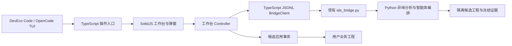

# ArkTS Refactor：DevEco Code TUI 插件技术设计

日期：2026-10-18。实现语言：TypeScript / TSX。插件、配置示例、测试与文档均位于 `opencode-plugin/`。

## 1. 目标与现有基础

在 DevEco Code 的终端界面内提供独立的 ArkTS 异味工作台。用户选择业务工程，检测或导入 HomeCheck JSON，查看风险与约束，在隔离候选工程中执行 Python 智能体编排，审阅 Diff，应用通过验证的候选并复检。

Python 后端继续使用本仓库的 `src/arkts_smell_refactor/`。现有 CLI 的 `start` 会自动修改业务工程，不适合作为“预览后应用”的入口。仓库另有已实现的 `deveco-plugin/src/main/resources/bridge/ide_bridge.py`，实际支持单请求进程、结构化事件、HomeCheck 检测、候选隔离和五层门禁。首版直接调用这份适配器，不复制 Python 业务逻辑，不改动 Java 插件或 Python 源码。

注意：`deveco-plugin/docs/backend-bridge-protocol.md` 包含更完整的未来协议设想。实现必须以实际 `ide_bridge.py` 为准，不能假定常驻连接、公开 cancel RPC 或 artifact RPC 已存在。

## 2. 宿主扩展调查与兼容条件

核查来源为 DevEco Code 官方公开仓库 `AgentGear/deveco-code` 的 `develop` 分支：

- [README：扩展能力](https://github.com/AgentGear/deveco-code/blob/develop/README.md)：兼容 OpenCode 插件，但一般服务器插件的配置说明不能证明原生 TUI 能力。
- [TUI 插件技术规范](https://github.com/AgentGear/deveco-code/blob/develop/packages/opencode/specs/tui-plugins.md)：TUI 使用独立配置、目标入口和生命周期。
- [TUI TypeScript API](https://github.com/AgentGear/deveco-code/blob/develop/packages/plugin/src/tui.ts)：路由、命令、模式、主题、弹窗和销毁接口。
- [插件包清单](https://github.com/AgentGear/deveco-code/blob/develop/packages/plugin/package.json)：`@opencode-ai/plugin/tui` 与 OpenTUI peer dependencies。

据源码选择 SolidJS + OpenTUI 的 TSX 组件，默认导出 `{ id, tui }`，通过 `api.route.register` 建立专属页面，用 `api.keymap.registerLayer` 提供命令面板、`/arkts` 和页面内按键。包提供 `exports["./tui"]`；不把 TUI 模块放到服务器插件列表。

配置文件路径由宿主构建版本决定。支持当前 API 的构建使用 `tui.json` 的 `plugin` 列表。实测 DevEco 使用 **`DEVECO_TUI_CONFIG`** 指定独立文件，OpenCode 使用 `OPENCODE_TUI_CONFIG`；两个变量不可混用。插件提供显式配置示例，不自动覆盖用户全局配置。

开始开发时本机安装的 `@deveco/deveco-code` 为 **0.1.8**，后按用户要求升级至 npm 最新版 **0.2.4**（2026-10-19 核验）。不能仅根据版本号宣称它包含 `develop` 分支的全部 API。首版提供能力检查；缺少 route/keymap/mode/lifecycle API 时明确报告升级要求。两个真实宿主均已读取独立 TUI 配置；登录／协议引导与最终工作台验证的实际状态见[使用与验证](usage-and-validation.md)。不会声称服务器插件能够自行注入旧版 TUI，也不实现宿主源码补丁。

## 3. 分层结构



建议目录：

```text
opencode-plugin/
  docs/                   技术、配置和验证文档
  examples/               tui.json 与插件设置示例
  src/
    tui.tsx               宿主注册、能力检查、生命周期
    ui/                   工作台、问题列表、证据、Diff
    controller.ts         操作串行化、选择、运行状态、日志
    bridge.ts             子进程与 JSONL 协议
    config.ts             配置验证和默认路径
    apply.ts              候选哈希验证与可恢复应用事务
    types.ts              实际桥接协议 DTO
  tests/                  协议、事务、控制器与真实 Python 冒烟测试
```

默认后端目录由插件源码位置向上定位仓库。业务工程默认取宿主当前目录，也支持显式设置。运行证据默认放到系统临时目录的专属目录，使用工程路径摘要隔离；禁止将 runs 放进业务工程，避免快照复制自身。配置中可指定 Python、后端、bridge、HomeCheck、Studio、Node、DevEco、hvigor、ohpm、linter、证据目录及 linterMode。相对路径与 configFile 相对于宿主当前目录解析；跨目录启动推荐绝对路径。

## 4. TUI 交互

2026-10-21 修订：设置文件缺失、JSON 解析失败或配置校验失败时，仍注册 `/arkts` 诊断入口，提示具体设置文件与错误。不得因业务配置无效而让命令静默消失；宿主 API 不兼容仍由插件能力检查报告。

2026-10-21 导航修订：六个视图入口移到工作区上方的独立固定导航栏；导航含一行入口及上下边框，80 列终端压缩周围留白。导航高度不可随日志内容收缩，详情面板限制内容绘制范围，只有详情正文滚动。左栏标题明确为“检测到的异味方法”，提示选择方式，每条显示方法名、异味类型与文件行号。选择条目后自动切到问题／风险视图；数字键导航仍保留。通过长日志滚动与窄屏原生渲染验证导航不被覆盖。

工作台包含顶部工程与运行状态、问题列表、详情区域和底部快捷键。详情按标签切换：问题／风险、阶段与结果、Diff、日志、历史、环境。

- `/arkts` 或命令面板进入工作台，Esc 返回先前宿主页面；离开页面不自动取消运行。
- 检测弹窗输入工程内目录或文件范围；默认整个工程。导入弹窗接受 JSON 文件路径，另提供粘贴 JSON 的入口。
- 列表选择问题后展示规则、文件与行号、原始消息和 supported 状态。不支持的规则可以浏览，不能准备或执行。
- 准备任务冻结基线并展示风险、推荐约束；可补充业务说明。
- 执行在候选副本中完成，展示后端阶段事件和有界日志。FAIL/BLOCKED 与协议错误分别展示。
- Diff 标签显示全部变更文件，可选择查看逐文件统一 Diff。二进制资源只显示路径、大小和摘要。
- 应用仅开放给 PASS 候选，弹窗列出写入文件数与工程路径。应用后独立显示“已应用，待复检”；复检使用 `task.validateApplied`，不再次执行重构 Agent。
- 历史从后端运行记录读取，候选可恢复后重新检查；旧证据不直接代表当前工程状态。
- 页面内快捷键使用专属模式，避免覆盖宿主聊天输入；弹窗打开时页面命令不处理。列表可键盘和鼠标操作，内容区域可滚动。

宽终端采用左右分栏，窄终端压缩为单列，以保证常见 80 列终端可用。颜色取自宿主主题；状态同时包含文字，不能只依靠颜色。

## 5. 实际后端协议

每个操作启动 `<python> -u <bridgePath>`，cwd 为 backendRoot，UTF-8 stdin 发送一行 JSON 后关闭。stdout 为 JSONL，stderr 为诊断。使用 `spawn` 的参数数组与 `shell:false`，路径和用户文本不拼接到 shell。

请求：

```json
{
  "protocolVersion": 1,
  "type": "request",
  "requestId": "UUID",
  "method": "issues.import",
  "projectRoot": "业务工程绝对路径",
  "config": {"backend": "后端根目录", "runs": "工程外证据目录"},
  "params": {"text": "[...]"}
}
```

| 方法 | 参数 | 返回与用途 |
| --- | --- | --- |
| `session.hello` | `{}` | 协议、adapterVersion、transport、supportedRules |
| `environment.inspect` | `{}` | tools、canDetect、canRefactor |
| `scan.start` | scopePath 或 files、可选 rules | issues、runDirectory |
| `issues.import` | file / text / records | issues |
| `task.prepare` | issue、instructions | taskHandle、risk、baselineFiles |
| `task.execute` | taskHandle | candidate、result |
| `task.validateCandidate` | candidateId | 新冻结候选、result |
| `candidate.restore` | candidateId | candidate、prepared、result |
| `candidate.describe` | candidateId | 冻结清单 |
| `candidate.check` | candidateId | PASS、全量基线、配置及冻结内容复核 |
| `task.validateApplied` | candidateId | 应用后门禁与问题复检 |
| `history.list` | `{}` | 至多 200 条当前工程记录 |

响应必须核对 protocolVersion、requestId、ok 和结果形状；非零退出不覆盖已有结构化错误。事件只有进程内 seq，不包含请求 ID，TypeScript 客户端绑定当前操作 ID，检查递增序号。支持 UTF-8 跨块拆分、粘连行、尾行、stderr、EOF、超时、非法 JSON 和单行上限。日志只保留有限字符，完整证据仍在 runs。

取消由 TypeScript 终止本操作的进程树：Windows 使用 PID 定向 `taskkill /T /F`，POSIX 使用独立进程组。收到取消请求后显示“停止中”，等待退出才显示“已中止”，不伪造后端 PASS 或正常完成状态。硬中断后的后端 session.json 可能仍为 RUNNING，历史适配器会显示 INTERRUPTED。不宣称具有后端协作式取消或自动恢复执行能力。

## 6. 候选应用与状态一致性

同一工作台只运行一个操作，应用与生成、检测、恢复互斥。重新导入或选择其他问题会清除不匹配的 prepared/candidate；开始新生成时旧候选不再可应用。

应用步骤：

1. 调用 `candidate.check` 复核后端 PASS、配置和完整工程快照。
2. 核对 originalRoot 属于当前业务工程，runDirectory 属于配置 runs；拒绝绝对/越界/重复路径、符号链接、junction、删除重命名与非生产变更。
3. 读取冻结 before/after，计算 SHA-256 并与清单和原始文件比对；新增文件必须不存在。
4. 在证据目录原子写入应用日志，再逐文件使用同目录临时文件替换，逐项更新日志。不能对整个工程宣称文件系统级原子性。
5. 遇到写入失败，仅在目标仍等于本事务写入内容时恢复冻结基线，后续用户编辑作为冲突保留。日志区分 APPLIED / ROLLED_BACK / CONFLICT / APPLYING。
6. 不实现未经核验的“全部回滚”。重启遇到未完成事务时报告日志位置，支持显式恢复到基线；复检失败不静默撤销用户代码。

候选验证、应用状态、应用后验证分开存储和展示。应用确认是插件运行时业务交互的一部分，开发阶段不触碰真实业务工程。

### 6.1 阶段提示（2026-10-21）

左侧列表底部保留灰色提示区，根据当前状态说明下一步：检测／导入、选择方法与 p 分析风险、x 生成、d 审阅后 a 应用、v 复检、r 回滚、失败／冲突查看证据。运行中说明等待和 c 中止；只读规则、回滚后和复检失败单独提示。宽屏提示位于边框底部，窄屏使用紧凑提示并为正文保留空间；列表容量扣除提示高度，避免提示被条目挤出。

## 7. 构建与验证计划

TypeScript 严格检查，TSX 交由宿主 OpenTUI Solid 转换器处理；交付包保留 TSX，避免用 React JSX 转换生成不兼容代码。固定依赖与 lockfile，OpenTUI / Solid 不打入独立副本，防止多个响应式运行时。开发使用 Plugin SDK 1.17.9、OpenTUI 0.3.4、SolidJS 1.9.12、Bun 1.3.14；发布包的 peer 要求优先于仓库 catalog。通过 overrides 更新间接依赖补丁，锁定文件记录实际解析结果。

验证优先覆盖跨进程和写文件边界：

- JSONL 多块中文、错误关联、崩溃与超时／取消进程树。
- 真实 Python bridge 的 hello、导入、风险准备，使用临时 Harmony 工程，不调用模型。
- Controller 的并发禁止、问题切换失效、运行结果和错误状态。
- PASS 候选应用、基线过期、摘要不符、路径逃逸、测试文件与软链接拒绝、失败恢复与用户修改冲突。
- TUI 的构建／类型检查，以及可行时的无终端渲染与按键验证。
- 记录真实宿主测试是否执行；没有真实 HomeCheck/模型/SDK 联调时不得宣称已完成端到端验证。

## 8. 首版限制

依赖同仓库已有 bridge 文件，npm 包不单独携带完整 Python 后端。按显式 backendRoot 使用本地源码；独立分发或通用服务协议以后再抽取。

只支持 bridge 已开放的四条规则：Feature Envy、Long Method、Switch Statement、Code Clone。检测与完整编排依赖本机外部工具；缺失时展示环境诊断或后端 BLOCKED。首版不扩展检测算法，不接入编辑器 WebView，不改变后端重构和测试隔离策略。
